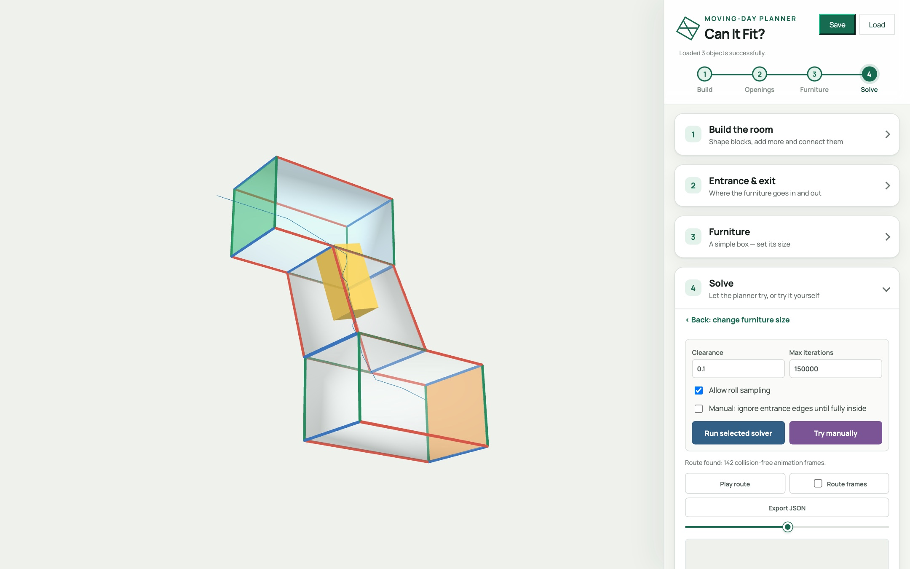
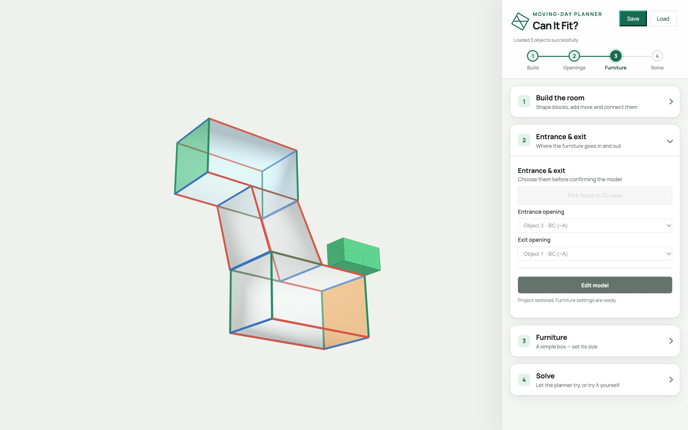
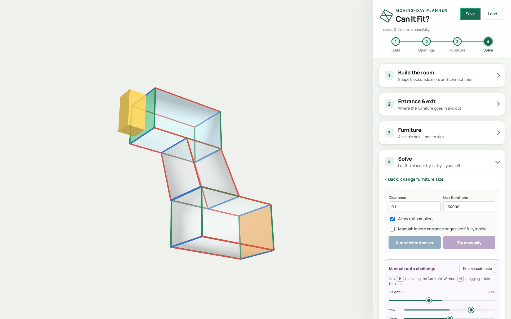

# Can It Fit? 🛋️

**Will that sofa make it through the hallway?** Build a room in 3D, drop in a piece of furniture, and let a motion planner find out, or try to squeeze it through yourself.

### 👉 [**Launch the app**](https://volcano1998.github.io/FurnitureSim_3D/)

<p align="center">
  
</p>

Runs entirely in your browser. No install, no account, no build step.

---

## What it does

- **3D room editor.** Every room is a box defined by an origin and three edge vectors (`O + s·A + t·B + u·C`). Stretch it, skew it, add more boxes, and connect them into L-shaped or winding hallways.
- **Entrance and exit.** Click two outside faces. Those are the only doorways; every other wall is solid.
- **Furniture as a box.** Set its length, width and height, plus a safety **clearance** that grows the box on every side.
- **Automatic solver.** **RRT-Connect** is a probabilistic planner that grows two trees through 6-D pose space until they meet. Roll sampling is on by default; turn it off for a faster, 5-D search.
- **Manual mode.** Hold <kbd>M</kbd> and drag the furniture yourself. The box turns green when legal, yellow when outside and red on collision. **Auto Pilot** snaps a furniture edge parallel to a room edge for you.
- **Hybrid mode.** Get the furniture inside by hand, then hand over to the solver from your exact pose.
- **Clear verdicts.** A pop-up tells you **"It fits!"** or **"No route found"**, and you can scrub the route on a timeline.

## Try it in 2 minutes

Try the built-in example: a hallway, a flight of stairs and another hallway, made from three blocks and two connections.

1. **Load the example**: download [`examples/stairs-and-hallway.json`](examples/stairs-and-hallway.json), open the app, and press **Load**. The staircase appears, with the entrance and exit already chosen.
2. **Build your own**: stretch blocks with the length sliders, tilt them with the angle sliders, press **+ Add object**, then **Connect two objects** and rotate or slide them until they line up. Any shape you can make from blocks works.
3. **Furniture**: enter its length, width and height (try `2.5 · 1.2 · 1.2`) with clearance `0.1`.
4. **Solve**: press **Try manually** and drag the furniture through, or press **Try auto-solver**.

Changed your mind? Click any earlier step in the progress bar to go back and edit.

<p align="center">
  
  
</p>

## How it works

| Question | Answer |
| --- | --- |
| How is a position stored? | A 6-D pose: `{ x, y, z, yaw, pitch, roll }` (Euler order `ZYX`, converted to a quaternion). |
| Is a pose legal? | The furniture's shell is sampled (5×5×5 grid minus the interior = 98 points, grown by clearance). Every point must lie inside the room's boxes. Moves are checked step by step, and walls can only be crossed through the entrance or exit polygon. |
| How is a path found? | RRT-Connect, seeded with ranked entrance and exit poses sampled across each opening at 15° then 5° resolution. |

RRT-Connect is probabilistic: finding a route proves the furniture fits, but failing to find one doesn't prove it can't. Run it again or raise the iteration limit. The app never "fixes" a failure by silently shrinking the clearance.

The slides walk through all of this with diagrams: [**download the PowerPoint with speaker notes**](slides/CanItFit_demo.pptx).

## Run it locally

Everything is static files, so any web server works:

```sh
git clone https://github.com/volcano1998/FurnitureSim_3D.git
cd FurnitureSim_3D
python3 -m http.server 8000
```

Then open <http://localhost:8000>. ES modules need to be served over HTTP, so double-clicking `index.html` won't work. Three.js and the fonts load from a CDN, so you need an internet connection.

## Project layout

| File | Purpose |
| --- | --- |
| `index.html`, `styles.css` | App markup and styling |
| `app.js` | Scene, room editing, step flow, UI state, animation |
| `planner.js` | Furniture geometry, collision checks, RRT-Connect solver |
| `manual.js` | Drag-it-yourself mode and Auto Pilot |
| `slides/` | The presentation (PowerPoint with speaker notes) |
| `AGENTS.md` | Conventions and notes for contributors and coding agents |

## Limitations

- Furniture is a single rigid box.
- Rooms are connected boxes (parallelepipeds), with no curves.
- It's a fast feasibility estimate, not a CAD-grade guarantee.

## Tech

[Three.js](https://threejs.org/) for rendering, plain ES modules, and no bundler or package manager.
